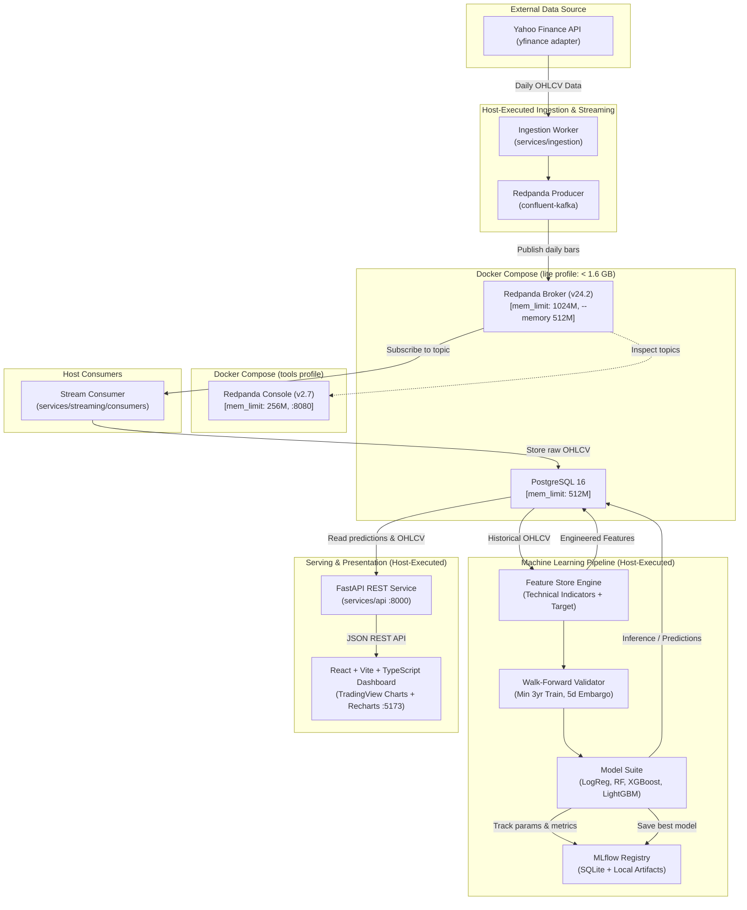

# StockPulse AI - System Architecture

StockPulse AI is an end-to-end stock market data ingestion, streaming, feature engineering, machine learning, and visualization platform designed specifically for predicting next-day price direction (UP/DOWN) across the Indian NIFTY 50 stock universe.

---

## 1. High-Level Architecture Diagram

---

## 2. Architectural Subsystems

### 2.1 Ingestion & Adapter Layer (`services/ingestion`)
- **Adapter Interface**: Wraps `yfinance` behind an abstract base class (`MarketDataAdapter`) to decouple external provider quirks from business logic.
- **Data Quality Gate**: Validates incoming bars against schemas, ensuring strictly positive prices, $High \ge Low$, and non-negative volume before publishing.

### 2.2 Streaming Layer (Redpanda)
- **Technology**: Redpanda (C++ Kafka-compatible engine) running in Docker.
- **M2 Mac Optimization**: Configured with `--memory 512M --smp 1 --overprovisioned` to run efficiently on an 8 GB RAM MacBook M2 without high CPU or memory thrashing.
- **Profiles**:
  - `lite`: Starts only PostgreSQL and Redpanda (default dev pipeline).
  - `tools`: Starts Redpanda Console on `:8080` on-demand for queue inspection.

### 2.3 Storage Layer (`db/`)
- **Primary Database**: PostgreSQL 16 Alpine containerized with persistent volumes.
- **Persistence Strategy**:
  - Raw adjusted daily bars in `ohlcv_daily` (PK: `ticker, date`).
  - Precomputed indicators in `features_daily`.
  - Predictions and performance evaluations in `predictions` and `model_metrics`.
- **Migrations**: Governed via Alembic.

### 2.4 ML & Feature Engineering (`services/ml`)
- **Target Formulation**: Binary direction classification:
  $$\text{target}_t = \begin{cases} 1 & \text{if } \text{Close}_{t+1} > \text{Close}_t \\ 0 & \text{otherwise} \end{cases}$$
- **Features**: Lagged returns (1, 2, 3, 5 days), SMA (5, 20, 50), EMA (12, 26), RSI (14), MACD, Bollinger Bands, ATR (14), OBV.
- **Walk-Forward Cross Validation**:
  - Minimum 3 years rolling training history.
  - Step size: 3 months.
  - Default **5 trading days embargo** between train and test to prevent autocorrelation and leakage.
- **Experiment Tracking**: MLflow configured with a local SQLite backend (`sqlite:///mlruns.db`) and local filesystem artifact storage.

### 2.5 API & Serving Layer (`services/api`)
- **FastAPI**: Synchronous SQLAlchemy 2.0 with the modern `psycopg` (v3) driver.
- **Endpoints**:
  - `/api/v1/health`: System health and database connectivity.
  - `/api/v1/tickers`: Active universe ticker listing.
  - `/api/v1/ohlcv/{ticker}`: Historical candlestick series.
  - `/api/v1/predictions/{ticker}`: Latest next-day direction forecasts and historic model accuracy.
  - `/api/v1/models/metrics`: Comparative leaderboard across baselines and trained models.

### 2.6 Frontend Layer (`frontend/`)
- **Stack**: React, Vite, TypeScript.
- **Visuals**:
  - TradingView Lightweight Charts for interactive candlestick price visualization.
  - Recharts for model evaluation curves (ROC curves, feature importances, calibration curves).
- **Execution**: Runs directly on host (`npm run dev`) against the FastAPI backend.

---

## 3. Resource Budgets & Memory Allocation

Target Machine: **MacBook Air/Pro M2 (Apple Silicon ARM64), 8 GB RAM, Docker Desktop budget: 4 GB**.

| Container / Process | Execution Mode | RAM Limit / Budget | CPU Allocation | Ports |
| :--- | :--- | :--- | :--- | :--- |
| **PostgreSQL 16** | Docker (`lite`) | `512 MB` | 1 core | `5432:5432` |
| **Redpanda Broker** | Docker (`lite`) | `1024 MB` (`--memory 512M`) | 1 core (`--smp 1`) | `9092:9092` |
| **Redpanda Console**| Docker (`tools`)| `256 MB` | 0.5 core | `8080:8080` |
| **Total Docker** | — | **~1.79 GB** (Well under 2.5 GB cap) | — | — |
| **FastAPI Backend** | Host Python 3.11 | ~150 MB | Host OS | `8000` |
| **ML Training Worker**| Host Python 3.11 | ~800 MB - 1.2 GB | Host OS | — |
| **Vite Dev Server** | Host Node 20 | ~150 MB | Host OS | `5173` |
